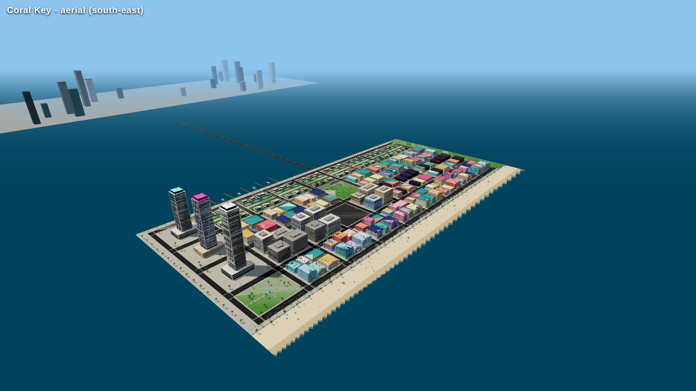
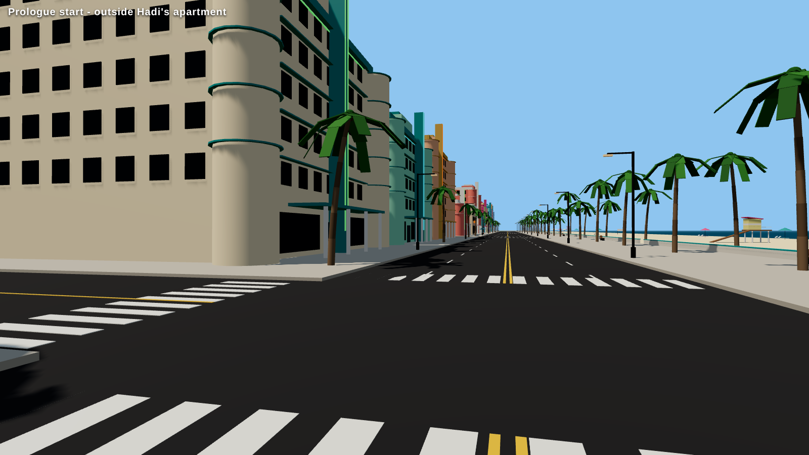
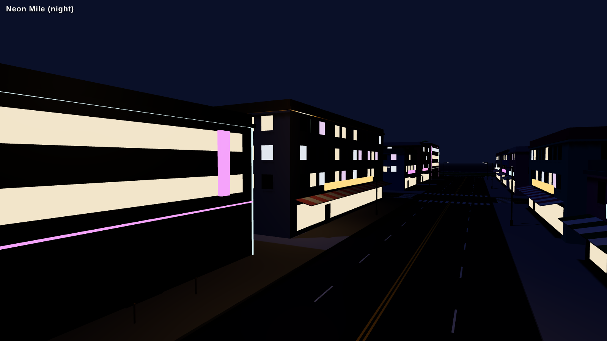
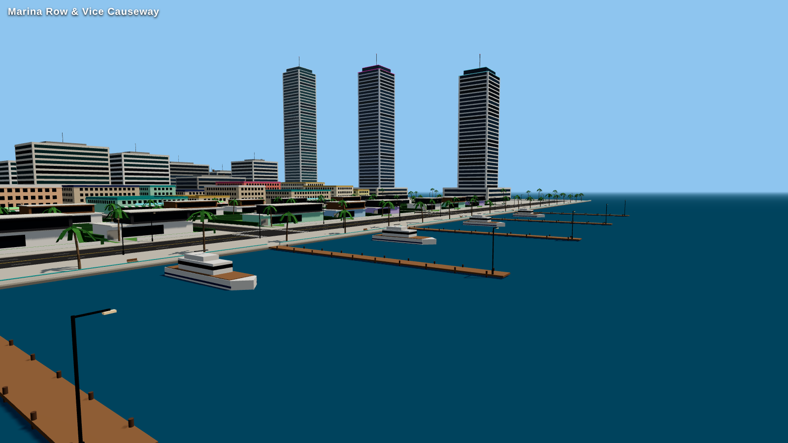
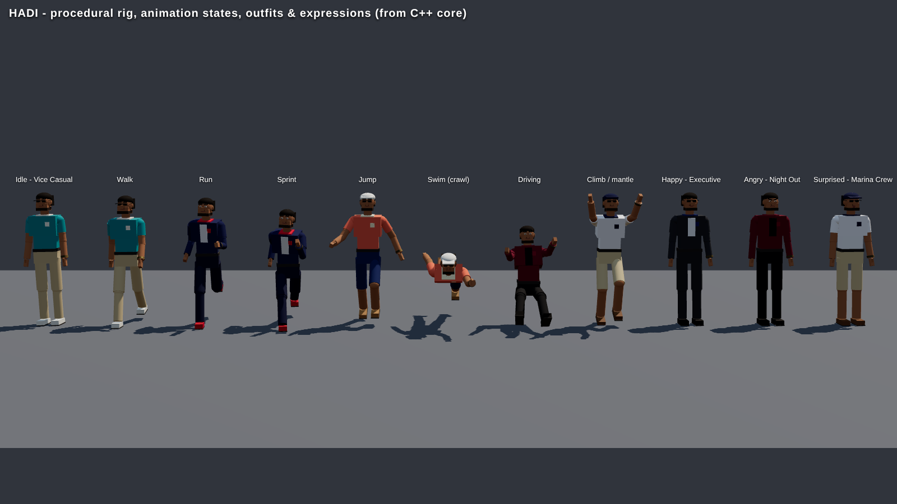

# HADI: VICE CITY

An original open-world, third-person action-adventure for **Unreal Engine 5**, set in Vice City,
a fictional tropical coastal metropolis. You play **Hadi**, who comes home to the island district
of **Coral Key** after three years away.

> Original IP: every character, place, vehicle, mission and line of dialogue in this repository is
> original. Nothing is taken from any existing game.



## What's playable in this build (Phases 1–4 + early 5, 7 and 9)

| Area | What you get |
|---|---|
| **Hadi** | Third-person character with walk / jog / sprint (stamina), jump, **swimming**, **ledge climbing**, fall damage, health regen, blackout & respawn. Procedural body with **6 outfits**, **facial expressions** (happy, angry, surprised, sad, focused), blinking and head-look. |
| **Coral Key** | ~1.2 km × 0.6 km island district: art-deco beachfront hotels, Palm Market shops, Neon Mile nightlife, bayside villas with pools, Flamingo Park, South Point towers, Marina Row with piers and yachts, a wide beach with lifeguard towers, the Vice Causeway and a downtown skyline. About 31,000 primitives, rendered as instanced meshes and streamed in 200 m cells. |
| **Driving** | Vento GT sports car: Chaos rigid body with ray-cast suspension, a friction-circle tyre model, anti-roll bars, an engine curve, brakes, reverse, a handbrake drift, drag and downforce. Chase and interior cameras, headlights at night, enter and exit. |
| **World** | 24-hour day/night cycle (sun, moon, sky atmosphere, volumetric clouds, height fog, Lumen GI). Neon, windows and street lights switch on at night. |
| **Gameplay** | Prologue mission chain with a GPS route and waypoint, a restaurant (heals), a clothing store (buy and wear), the safehouse (save, sleep, wardrobe), 12 hidden **Neon Flamingo** collectibles, money, statistics, autosave, save/load. |
| **UI** | Main menu with a fly-over camera; pause, settings, statistics, controls, shop, wardrobe and safehouse menus; rotating minimap with GPS; health and stamina bars; money and clock; objective panel; interaction prompts; notifications; mission banners; speedometer; FPS counter. Keyboard, mouse and gamepad all work. |
| **Settings** | Quality presets, auto-detect, window mode, resolution, V-Sync, frame limit, motion blur, depth of field, **hardware ray tracing (Lumen HWRT)**, FOV, look sensitivity, invert look, FPS display. All saved. |

| Street level | Night on Neon Mile | Marina Row |
|---|---|---|
|  |  |  |



*Screenshots come from the browser previewer (`Tools/Preview`), which renders exactly the primitives and
poses the C++ simulation core feeds to Unreal. In the engine the same scene gets Lumen GI, reflections,
virtual shadow maps, sky atmosphere, volumetric clouds and animated water.*

## Getting started

**Requirements:** Windows 10/11, **Unreal Engine 5.6** (5.4+ should work; right-click the `.uproject` and use
*Switch Unreal Engine version* for other versions), and **Visual Studio 2022** with the
*Game development with C++* workload. A DX12 GPU is recommended; ray tracing is optional.

1. Clone the repository. Install Git LFS (`git lfs install`), which future binary assets will use.
2. Double-click `HadiViceCity.uproject`. When asked *"The following modules are missing or built with a
   different engine version… Would you like to rebuild them now?"*, choose **Yes**. You can also right-click
   the `.uproject`, choose **Generate Visual Studio project files**, and build `HadiViceCityEditor` (Development Editor).
3. On first launch the editor runs `Content/Python/init_unreal.py`, which creates the three master
   materials in `/Game/Hadi/Materials`. Look for `[Hadi] materials ready` in the Output Log. Commit those
   assets. Until they exist the game still runs, using engine fallback materials.
4. Press **Play**. The game boots into the main menu over a fly-over of Coral Key. Choose **New Game**.

> In the editor, **Esc** ends Play-In-Editor, so use **P** to open the pause menu (Esc works in packaged
> and standalone builds).

### Controls

| Action | Keyboard / mouse | Gamepad |
|---|---|---|
| Move / steer | W A S D | Left stick |
| Camera | Mouse | Right stick |
| Sprint (hold) | Left Shift | X / Square |
| Walk toggle | Left Ctrl | L3 |
| Jump / climb / swim out / handbrake | Space | A / Cross |
| Interact / enter / exit vehicle | E or F | Y / Triangle |
| Accelerate / brake & reverse | W / S (or ↑ / ↓) | RT / LT |
| Vehicle camera (chase / interior) | V | View |
| Camera distance | Mouse wheel | – |
| Pause | Esc or P | Menu |

## How it's built

The world, Hadi's body, the vehicle and the whole UI are generated from C++ at runtime, so the
project has no hand-made binary maps or meshes that can drift out of sync. The game boots into the
engine's empty `Entry` map, and `AHadiGameMode::StartPlay` builds Vice City. Details are in
[Docs/ARCHITECTURE.md](Docs/ARCHITECTURE.md).

```
HadiViceCity.uproject          UE5 project (Enhanced Input, Python scripting)
Config/                        Lumen, VSM, ray tracing, DX12/SM6, input, packaging
Content/Python/                editor scripts that generate the master materials
Source/HadiViceCity/
  Public|Private/Core/         engine-agnostic simulation core (city, road graph/GPS, rig & animation,
                               time of day, minimap math): unit-tested without Unreal
  .../Characters/              AHadiCharacter, UHadiRigComponent
  .../Vehicles/                AHadiVehicle
  .../World/                   city generator + streaming cells, environment, material subsystem
  .../Gameplay/                interaction system, shops, safehouse, collectibles, waypoint
  .../Game/                    game mode, game instance, save game, profile, user settings
  .../Player/                  player controller (all Enhanced Input in code)
  .../UI/                      HUD, menus, minimap
Tools/CoreTests/               unit tests for the core (19,973 checks)
Tools/UEStubCheck/             offline compile check of the Unreal layer
Tools/Preview/                 browser previewer + screenshot renderer
Docs/                          architecture, development checklist, story bible, screenshots
```

## Verification

This repository was developed in a cloud environment **without Unreal Engine or a GPU**, so it is
verified in three layers:

1. **Simulation core unit tests** (`Tools/CoreTests/run_tests.sh`, any C++17 compiler) cover 19,973 checks:
   deterministic generation, no buildings on roads or overlapping, every gameplay point reachable and
   outside buildings, a connected road network, GPS route sanity, feet planted through every gait,
   blinking and expressions, the day/night curve, and minimap projection.
2. **Visual preview** (`Tools/Preview/build_preview.sh`) renders the generated city and Hadi's poses in
   headless Chromium. All screenshots above come from it.
3. **Unreal-layer compile check** (`python3 Tools/UEStubCheck/run_stub_check.py`) compiles every `.cpp`
   (individually and as one unity build) against stub engine headers, with UE5's shadowing-as-error rule
   and strict float/double checks. It passes with zero warnings. **It is not a real UnrealBuildTool build:**
   the stubs encode the UE 5.x API by hand, so the first build on your PC is the real compile test. If
   anything fails there, paste the error log back and it will be fixed.

The in-engine smoke test to run after the first build is in
[Docs/DEVELOPMENT_CHECKLIST.md](Docs/DEVELOPMENT_CHECKLIST.md#in-engine-smoke-test).

## Roadmap

Development follows the 10-phase plan in [Docs/DEVELOPMENT_CHECKLIST.md](Docs/DEVELOPMENT_CHECKLIST.md).
Next up: **Phase 5** (more vehicles: SUV, motorcycle, truck, boat, helicopter; damage; garages) and
**Phase 6** (pedestrians with daily routines, traffic with signals and lanes). The story is outlined in
[Docs/STORY_BIBLE.md](Docs/STORY_BIBLE.md).
